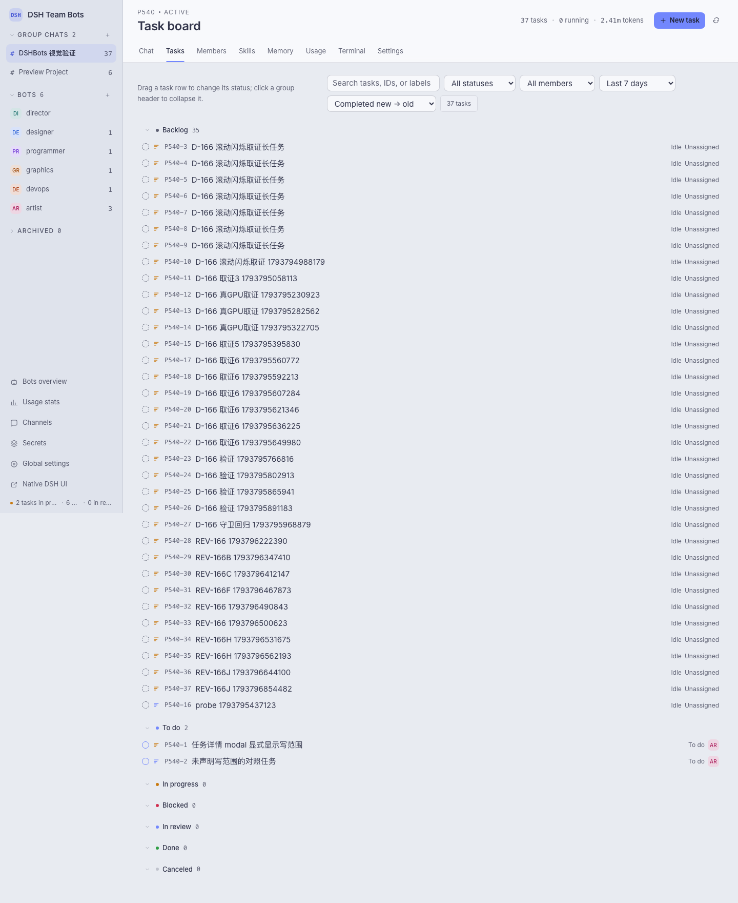
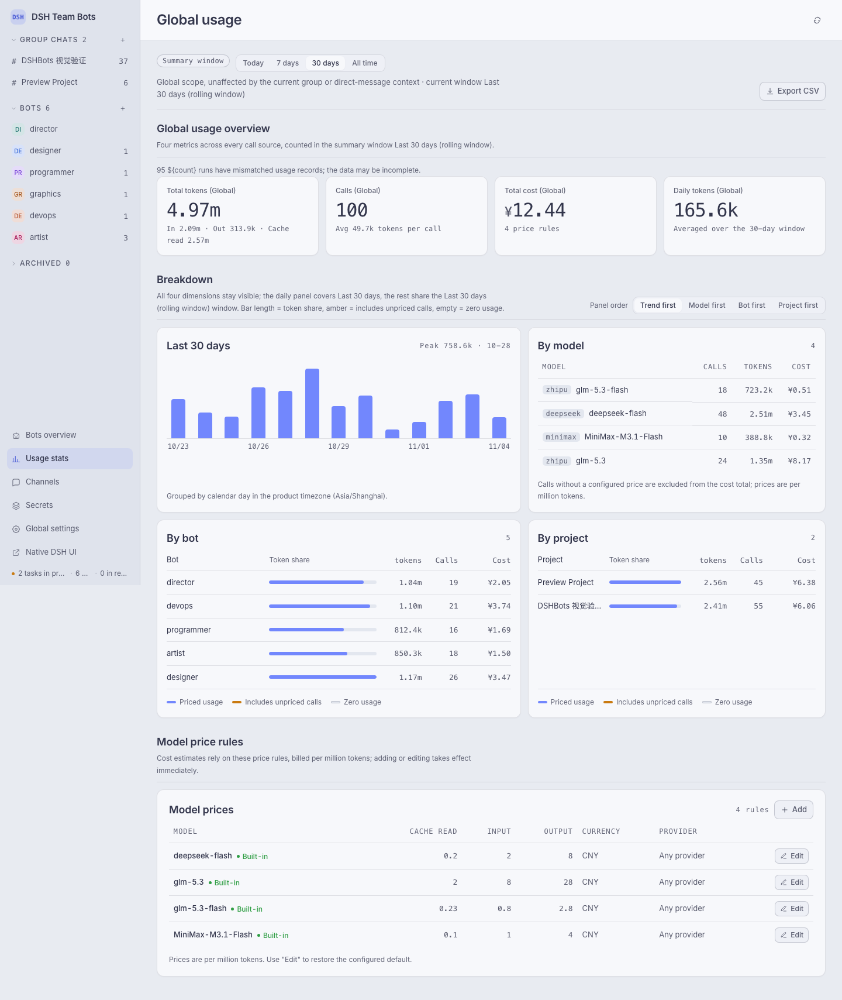
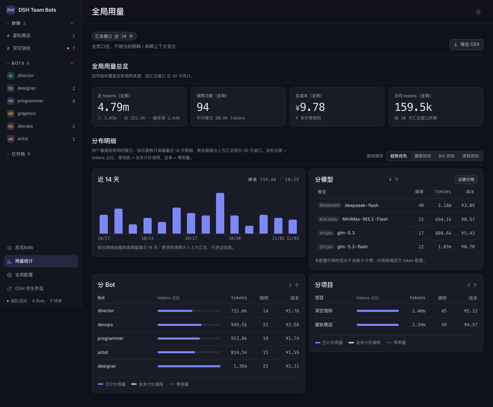

# DSH Team Bots

DSH 团队 Bots 插件（`dsh-team-bots`）：在 DSH 里组织一支会协作的 Bot 小队——项目群聊、任务派发、写范围并行调度、终端与用量统计都装在同一个工作台里。


## 核心特性

- **项目群聊**：每个项目一间群聊和一位项目总监 Bot。支持普通消息、`@Bot`、`/task @Bot 标题`、`/remember`、`/clear`，输入 `/` 或 `@` 弹出命令、技能与成员补全。
- **任务看板**：Linear 风格任务面板，按状态分组、父子任务树、优先级与负责人、评论直投运行中的会话、拖拽流转；任务详情内联展示交付产物。
- **写范围并行调度**：任务声明自己要写的路径后，同项目的两个写运行按声明范围判定：范围互不重叠即可并行，重叠或有一方未声明则串行，既不误踩共享工作区也不空耗并发；任务会话彼此独立，任务与群聊互不阻塞。
- **Bot 记忆与技能池**：Bot、项目两级长期记忆，每轮结束自动做记忆审查；共享技能池固定在本机 `~/.agents/skills`，项目还能自带 `.agents/skills`、`.claude/skills`、`.codex/skills`。
- **版本化进化**：角色、模型、强度与技能变更走提案审批，Bot 配置保留不可变历史，可回滚。
- **团队工具**：注册 `team_assign_task`、`team_review_task`、`team_remember`、`team_recall`、`team_propose_evolution`、`team_message_bot`、`team_request_secret` 七个工具，Bot 之间可直接私信协作。
- **密钥管道**：密钥 AES-256-GCM 加密落库并物化到项目 `.team/secrets.env`，消息与运行输出里一律掩码为 `$名称`。
- **用量统计**：全局 / 项目 / Bot 三档口径归集 token、调用次数、成本与运行时长，成本按可配置的模型价格计算，未配置价格不按 0 计费。

## 安装与启用

要求 Node 22.19+ 与已安装的 DSH CLI（`dsh --version` 自查）。插件随 DSH Web 在本机进程内运行：

```sh
cd <repo>
npm pack                                        # 产出 dsh-team-bots-<version>.tgz
dsh plugin --profile <名字> add ./dsh-team-bots-<version>.tgz
dsh --profile <名字>                             # 从启动日志读取 dsh web 的带 token 入口
```

一键刷新（打包到仓库 `.dist/` 并重装进指定 profile，缺省装 `team-bots`）：

```sh
npm run profile:install -- --profile <名字>
```

团队数据与 profile 解耦：数据目录只由 `DSH_TEAM_WORKSPACE` / `DSH_TEAM_DATA` 决定（缺省 `~/.dsh/workspace/team-bots/.data`），换 profile 安装或并存多份安装读写的都是同一份数据。共享技能池固定在本机 `~/.agents/skills`。常用变量模板见 `.env.example`，请用 direnv 或编辑器 dotenv 插件导出，不要在仓库根目录放 `.env`。

```text
http://<host>:<port>/                     自动登录，直达团队工作台
http://<host>:<port>/api/dsh-team/ui      DSH Team Bots 团队工作台（直连）
http://<host>:<port>/index.html           DSH 原生 Web 界面
```

首次打开首页会用当前启动 token 兑换一枚 30 天登录 Cookie 并跳转到工作台，无需手动步骤。自动登录意味着能连上该端口的人即获得 owner 访问，服务只应监听本机或受信任网络。

常用环境变量：

| 变量 | 默认 | 作用 |
| --- | --- | --- |
| `DSH_TEAM_WORKSPACE` | `~/.dsh/workspace/team-bots` | 团队工作区根目录 |
| `DSH_TEAM_DATA` | `<工作区>/.data` | 团队 SQLite 与运行记录 |
| `DSH_TEAM_MAX_RUNS` | `3` | 全局并发运行上限 |
| `DSH_TEAM_RUN_TIMEOUT_MS` | `900000` | 单个运行的硬超时 |
| `DSH_TEAM_MAX_RUN_TOKENS` | `0` | 单运行 token 上限，0 关闭 |
| `DSH_TEAM_STALL_TIMEOUT_MS` | `600000` | 多久没有新事件判定卡住 |
| `DSH_TEAM_SECRET_KEY` | — | 密钥主密钥（64 位十六进制） |
| `DSH_TEAM_MODEL_PRICES` | — | 模型价格 JSON 数组 |
| `DSH_TEAM_AGENT_TEAM` | `0` | 是否启用原生 Agent Teams 层 |
| `DSH_TEAM_WECHAT` | `0` | 微信通道 |

## 开发

```sh
npm run dev        # http://127.0.0.1:4317，假 runtime，数据写在 .dev/
npm test           # node --test "tests/*.test.js"
npm run doctor     # 检查 Node/DSH 版本、工作区与技能池路径的可写性
```

`src/` 是服务端与调度，`ui/` 是工作台前端，`tests/` 是测试，`docs/` 放设计与评审文档。开发预览无认证，不动任何 DSH 配置，不能用于生产。

CI：push `v*` tag 自动发 npm——工作流跑全量测试，全绿后发布到 registry.npmjs.org（见 `.github/workflows/publish.yml`）。

## 截图

任务看板按状态分组，父子任务与待验收标记一眼可见：



用量统计区分汇总窗口与近 14 天明细，成本按模型价格计算：



终端页直接执行命令并保留历史：


暗色模式：




## 安全边界

- 本插件不自带沙箱：Bot 会话在 DSH 的 `danger-full-access` 下以当前用户身份执行命令，能读写该用户可达的一切文件。
- `<工作区>/{project}` 只是逻辑隔离，不是强沙箱；互不信任的团队不要共用同一个 DSH 实例与工作区。
- 对外提供服务必须走 HTTPS 反向代理，并正确转发 Host 与 WebSocket。

## License

Apache-2.0，见 `LICENSE` 与 `NOTICE`。
