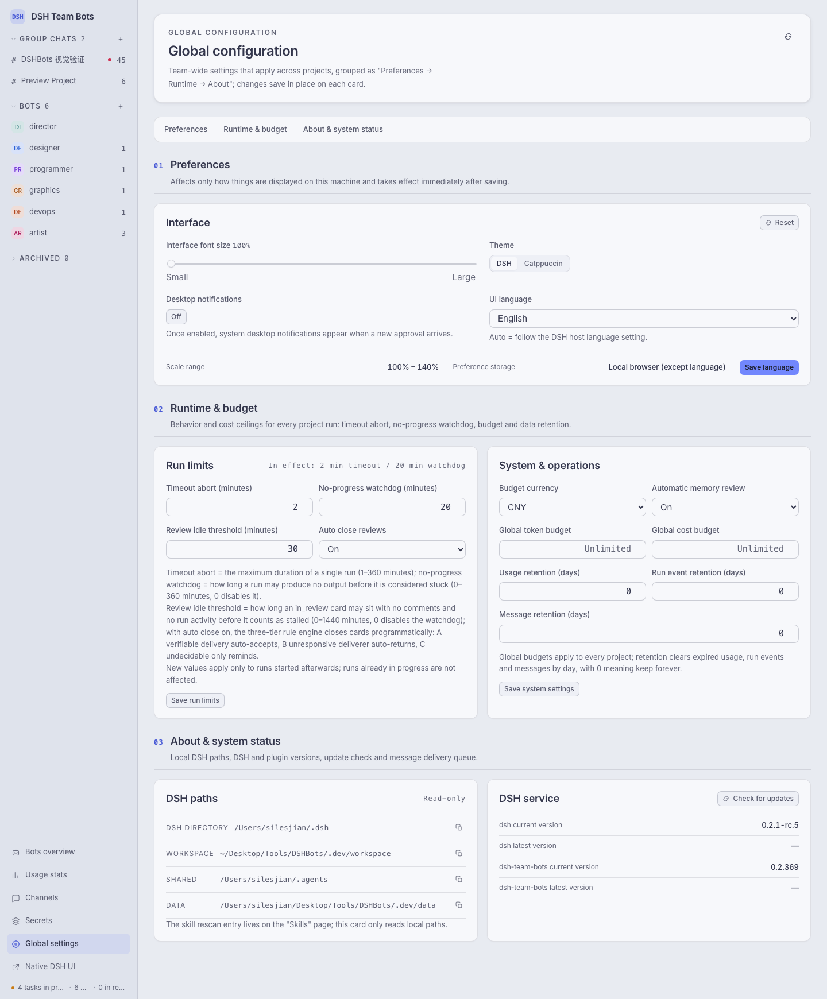

# DSH Team Bots

[中文](docs/README.zh.md)

`dsh-team-bots` is a DSH plugin that turns one workspace into a team: project group chats, a task board, write-scope parallel scheduling, shared memory and skills, approval cards, usage and cost, and a personal WeChat channel. Every run keeps its trajectory, duration, token count and cost.


## Requirements

- Node.js ≥ 22.19
- the DSH CLI (`dsh`)

The plugin runs inside the DSH Web process. It has no standalone service and no port of its own.

## Install

```sh
dsh plugin --profile <name> add dsh-team-bots
```

From a checkout (packs the working tree and installs it into the profile):

```sh
npm run profile:install -- --profile <name>
```

Plugin files inside a profile are a snapshot. After changing code, reinstall — otherwise the page keeps serving the old build.

## Open the workspace

```text
http://<host>:<port>/                     DSH web, auto-login into the team workspace
http://<host>:<port>/api/dsh-team/ui      the team workspace itself
```

The first visit exchanges the current startup token for a 30-day login cookie. Auto-login means anyone who can reach the port becomes owner, so listen on the local machine or a trusted network; for public use put an HTTPS reverse proxy in front that forwards Host and WebSocket correctly.

## What the workspace does

### Group chats and dispatch

Every project is a group chat. A bot can also be addressed one-to-one in a dispatch view. All traffic for one bot — task dispatch, group chat, direct message, one-to-one chat — lands on a single control-plane session, and that bot runs one task at a time; different bots still run in parallel.

A group chat has three reply modes (switchable in project settings): **Director first** (default — the director answers when nobody is addressed), **Everyone responds** (all members answer when nobody is addressed), and **Mentioned only** (a message with no explicit @mention or bot reply wakes nobody immediately, but the director's thinking bubble appears at once and the director auto-claims it after 1 second; explicit mentions and replies deliver in every mode). The message tail window injected into bot context is tiered: messages that mention the bot keep their full text with a marker, while other bots' chatter collapses into short background digests.

### Task board

States: backlog, todo, in progress, blocked, in review, done, canceled. A card carries assignee, priority, parent/child links, tags, write scopes, an optional time budget (a hard limit that aborts the run), comments, and its own usage. Rows are grouped by state and can be dragged onto another group to change status.

Acceptance has a mechanical gate: **whoever built does not verify** — a bot reviewer that has ever been the card's assignee (including past reassignments) is refused; hand the review to a bot that never executed the card, or accept from the workbench board as the human owner. Returning a card for rework is not gated. Amending a card (`team_assign_task` re-dispatch with card edits) accepts an optional `expected_version` mutation fence: if the card changed since you last saw it (delivery, transition, another edit) the write is refused with the most recent changes listed, so you can re-decide in place.

Task status transitions now write an authoritative `status` task event in the same transaction as the update, so the event stream fully replays the task state machine; the `task_projection_drift` API is a read-only check that replays the ledger and reports any drift from the projection.

### Write scopes and parallel scheduling

A card declares the paths it will write, relative to the project working directory. Two runs of the same project run in parallel only when both declare scopes and the path prefixes do not overlap; a card with no declared scope is treated as serial. An urgent card may be exempted from the queue — the exemption is written into the card's creation message rather than applied silently.

### Memory, skills, evolution proposals

Memory entries are written, reviewed, frozen and archived by the owner, and are readable by every bot in the project. After a task is accepted, the assignee's next run in that project carries a one-time reminder to persist durable conclusions into memory (`team_remember`) while they are fresh, instead of waiting for session rollover. Skills come from a shared skill root plus per-project skills; changing them goes through a proposal, an approval and an apply, with a canary stage before promotion to full effect. The same path can change a bot's role instructions.

### Approval and question cards

When a bot asks for a tool approval, a secret, or an answer, the workspace shows a card in the chat. The owner approves, denies or answers in place, and the decision is recorded on the card.

### Usage and cost

The usage page breaks the numbers down by model, bot and project, exports CSV, and reads model prices from configuration.


### Workspace settings

Run limits (timeout abort, no-progress watchdog, review idle threshold), budgets and retention windows are set per workspace, together with the interface preferences and the local DSH paths.



### Terminal, channels, secrets

A per-project terminal runs commands in the project directory. The WeChat channel binds by QR code and pushes task activity to the owner's WeChat. Secrets are scoped to the team or to one project; values are only ever shown as a fingerprint and are handed out as one-time runtime copies that expire.

## Configuration

| Variable | Default | Meaning |
| --- | --- | --- |
| `DSH_TEAM_WORKSPACE` | `~/.dsh/workspace/team-bots` | team workspace root |
| `DSH_TEAM_DATA` | `<workspace>/.data` | database and run records |

Every other variable, its default, and its resolution order (explicit env > value saved in the workspace > code default) live in `src/config.ts`; `.env.example` lists the common ones. Do not put a `.env` file in the repository root — it would leak `DSH_*` into `npm test` and `npm run dev`.

`DSH_TEAM_DATA` holds `team.sqlite`, `wechat-channel.sqlite`, `secret.key`, `memory/`, `messages/` and `secrets-runtime/`. Back up `secret.key` together with the data: without it the stored ciphertext cannot be decrypted.

## Develop

```sh
npm install
npm run build       # compile TypeScript into the shipped .js files
npm run typecheck
npm test            # build, then node --test over tests/ and scripts/
npm run dev         # local dev server on http://127.0.0.1:4317
npm run doctor      # check node, dsh, paths and profile references
```

Additional harnesses: `npm run backup` / `npm run restore-check` for data, `npm run verify:agent-team` for the agent-team capability, `npm run load-test` and `npm run fault-test` for the runtime.

Repository layout:

```text
ui/            the browser workspace (modules, styles, zh/en copy)
src/           HTTP API, database, runtime and domain services
src/services/  domain logic: chat, tasks, scheduler, memory, skills, approvals, usage
src/tools.ts   the tool surface bots see (team_* tools)
scripts/       build, dev server, doctor, release, backup, test harnesses
tests/         node:test suites
```

## Release

```sh
npm run release            # add --dry-run to print the plan without touching anything
```

The tool pushes `dev`, lands it on `main` (fast-forward when possible, otherwise a content snapshot), pushes `main` and the tag, then syncs `dev` back. Publishing uses npm OIDC trusted publishing — no `NPM_TOKEN` — and the workflow installs npm ≥ 11.5.1 before publishing.

## License

Apache-2.0, see `LICENSE` and `NOTICE`.
