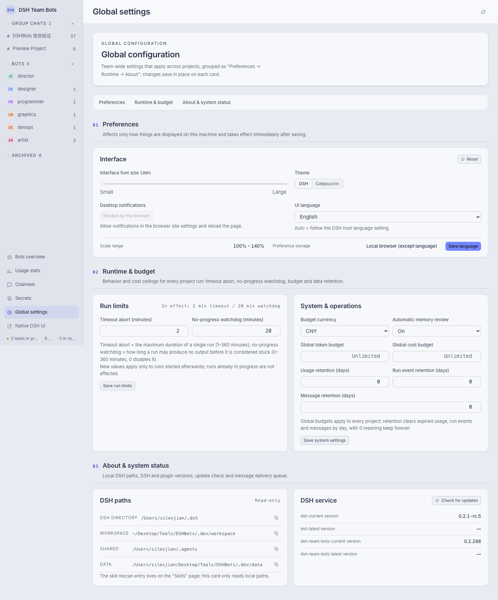

# DSH Team Bots

[中文](docs/README.zh.md)

DSH Team Bots is the npm package `dsh-team-bots`, a DSH (DeepSeek Harness) plugin that packs a collaborating crew of bots into one workspace: project group chats, a task board, write-scope parallel scheduling, memory and skills, usage and cost, plus a personal WeChat channel.


This file is the English edition of the project documentation; the Chinese edition is [docs/README.zh.md](docs/README.zh.md).

---

## 1. Project Overview

`dsh-team-bots` runs inside the DSH Web process — no separate service — and lets several bots divide work across the same project spaces, exposing the collaboration as an operable web workspace.

1. **Collaboration happens in projects, not in a chat window.** Each project has its own group chat, members, tasks and working directory; the project director bot splits, assigns and accepts work there.
2. **Parallelism is declared, not hoped for.** A task declares the paths it will write; the scheduler runs two write runs in the same project in parallel only when both declare and their path prefixes do not overlap. Anything undeclared is treated as serial.
3. **Everything is traceable.** Every run keeps a trajectory, duration, token count and cost; bot configuration keeps an immutable history that can be rolled back; secrets stay encrypted at rest and are materialised as one-time plaintext files that are burned after use.

The repository shape: `index.js` is the plugin entry point, `src/` is the server side and scheduler, `ui/` is the workspace frontend, `tests/` holds the guard tests, and `docs/` holds design specs, review records and screenshots.

---

## 2. Quick Start

### 2.1 Requirements and install

Node.js ≥ 22.19 (see `engines` in `package.json`) and the DSH CLI installed (`dsh --version`); the plugin runs inside the DSH Web process, with no standalone process or port.

```sh
cd <repo>
npm pack                                        # produces dsh-team-bots-<version>.tgz
dsh plugin --profile <name> add ./dsh-team-bots-<version>.tgz
dsh --profile <name>                             # read the tokenised dsh web entry from the startup log
```

### 2.2 Reinstall and local preview

```sh
npm run profile:install -- --profile <name>     # installs into team-bots when --profile is omitted
npm run dev                                     # local preview at http://127.0.0.1:4317, fake runtime
```

`profile:install` packs the repository into `.dist/`, reinstalls it with `dsh plugin add`, and rewrites the profile patch file to trigger a recomposition. **Plugin files inside a profile are a snapshot and DSH does not pick up replaced files on its own**: after changing code you must reinstall, or the page sticks at "connecting to the team space". Team data is decoupled from the profile: `DSH_TEAM_WORKSPACE` / `DSH_TEAM_DATA` alone decide the data directory. The preview server uses a fake DSH runtime — **no authentication, no DSH configuration touched, not for production**; override the port with `PORT`.

### 2.3 Data, secrets and skills

Data lives under `DSH_TEAM_DATA` (default `<workspace>/.data`, workspace root `DSH_TEAM_WORKSPACE`, default `~/.dsh/workspace/team-bots`): `team.sqlite`, `wechat-channel.sqlite`, `secret.key`, `memory/`, `messages/` and `secrets-runtime/` (burned on TTL expiry). Back up `secret.key` together with the data — without it the existing ciphertext cannot be decrypted. Schema changes go through the idempotent migrations in `src/db-migrations.js`. Skills come from a shared pool fixed at `~/.agents/skills`, plus project-local `<project>/.agents/skills`, `<project>/.claude/skills` and `<project>/.codex/skills`.

A template for the common variables lives in `.env.example`; **do not put a `.env` file in the repository root**, because that would leak `DSH_*` into `npm test` and `npm run dev`.

### 2.4 Entry points and environment variables

```text
http://<host>:<port>/                     auto-login, straight into the team workspace
http://<host>:<port>/api/dsh-team/ui      the DSH Team Bots workspace (direct)
http://<host>:<port>/index.html           the native DSH web UI
```

The first visit to the home page exchanges the current startup token for a 30-day login cookie. Auto-login means **anyone who can reach the port becomes owner**, so listen on the local machine or a trusted network; public exposure needs an HTTPS reverse proxy that forwards Host and WebSocket correctly.

Defaults come from `src/config.js` (resolution order: explicit env > value saved on the page > code default). Common variables: `DSH_TEAM_MAX_RUNS` (6), `DSH_TEAM_RUN_TIMEOUT_MS` (3600000), `DSH_TEAM_MAX_RUN_TOKENS` (0), `DSH_TEAM_APPROVAL_TIMEOUT_MS` (180000), `DSH_TEAM_SECRETS_TTL_MS` (1800000), `DSH_TEAM_UI_LANGUAGE` (`auto`), `DSH_TEAM_AGENT_TEAM` / `DSH_TEAM_MAX_TEAMMATES` (0 / 3), `DSH_TEAM_WECHAT` (0), `DSH_TEAM_SECRET_KEY`. The full list and every default live in `src/config.js`.

---

## 3. Feature Overview

- **Project group chat:** every project has one group chat and one director bot. Plain messages, `@Bot`, `/task @Bot <title>`, `/remember` and `/clear` are supported, with `/` and `@` completions for commands, skills and members. Conclusions stay in the chat; full deliveries go to task comments.
- **Task board:** a Linear-style panel grouped by status, with a parent/child tree, priority and assignee, comments delivered into running sessions, drag-to-transition, and inline delivery artefacts and run list.
- **Write-scope parallel scheduling:** declared write scopes decide whether two write runs in one project may run at once; write runs are independent, and neither tasks nor chats block one another.
- **Memory and skill pool:** bot- and project-level long-term memory with a human review queue; the shared skill pool is fixed at `~/.agents/skills` and projects can add their own skill directories; skill changes go through proposal approval with rollback snapshots.
- **Versioned evolution and team tools:** role, model, intensity and skill changes go through proposal approval, and bot configuration keeps an immutable, rollback-able history. The plugin registers the team tools for task assignment, review, memory, recall, evolution proposals, direct bot messaging and secret requests.
- **Secret pipeline:** AES-256-GCM at rest; once approved, materialised into the data directory (**not the project workspace**) and burned when the run ends or the TTL expires; messages and run output are always masked as `$<name>`.
- **Usage and cost:** tokens, call counts, cost and runtime aggregated at global, project and bot level; cost comes from configurable model prices and calls without a price are not billed as zero; CSV export and monthly reconciliation are available.
- **Approvals, questions and terminal:** privilege or human-answer requests become workspace cards — approvals time out to `rejected`, an expired question stays answerable. Each project has an interactive terminal with a hard timeout, live tailing, cancellation and persisted history.
- **WeChat channel and code hygiene:** QR-authorised task push plus a plain-text command surface (see 4.4); a per-project line limit (800 by default) is scanned at the end of every run, and an over-limit file triggers one 【系统指令】 asking the director to schedule a split card.

---

## 4. Architecture and Layout

### 4.1 Wiring

`apply(ctx, config)` in `index.js` is the only entry point, and its order is the dependency order:

```
resolveConfig(config)      → src/config.js      parse env / injected config into a defaulted config
openDatabase(dbPath)       → src/db.js          open and migrate SQLite
new TeamService(...)       → src/service.js     domain facade (methods mounted from src/services/*)
new DshRuntime(...)        → src/runtime.js     host runtime adapter (prompts, sessions, model recovery)
installTeamTools(...)      → src/tools.js       register the team tools
installSkillProvider(...)  → src/skills.js      wire the skill pool
installHttp(...)           → src/http.js        HTTP routes and UI static slices
```

`service.initialize()` creates the database and seeds the default bots and buddies first; only then does `service.start()` bring up the scheduler.

### 4.2 The `src/` directory

| Path | Responsibility |
| --- | --- |
| `index.js`, `src/config.js` | plugin entry point; configuration resolution (env / page-saved value / code default) |
| `src/db.js`, `src/db-migrations.js` | SQLite access and idempotent migrations (a new column can be added repeatedly) |
| `src/service.js`, `src/services/` | the `TeamService` facade and its domain methods: bots, projects, chat, tasks, runs, scheduler, memory, secrets, proposals, terminal, usage, system, wechat, approvals, questions, hygiene, write-scopes, and more |
| `src/runtime.js`, `src/services/runtime/` | host adapter: prompt assembly, session lifecycle, model recovery, trajectories |
| `src/http.js`, `src/api.js`, `src/tools.js`, `src/botmsg.js`, `src/skill-parse.js` | HTTP routes and UI slices, the `POST /api/dsh-team/api` dispatch entry, team tools, bot-to-bot messages, skill package parsing |
| `src/wechat/`, `src/secrets.js`, `src/pricing.js`, `src/usage*.js`, `src/skills*.js`, `src/seed-bots.js`, `src/updater.js`, `src/paths.js`, `src/util.js`, `src/errors.js` | WeChat channel, secret crypto, pricing and usage, skill pools, seed bots, update check, path boundaries, utilities, error types |

### 4.3 The `ui/` directory

The frontend is plain ES modules with no build step; every slice is loaded straight from an HTTP route. `ui/modules/` holds one module per domain (state, api, chat, tasks, modal-layer, modal-forms, events-*, and more) and `ui/styles/` one CSS file per domain; `ui/i18n/{zh,en}.js` hold the interface dictionaries.

Two hard conventions:

1. **Style slices must be registered.** The concatenation order is decided by `UI_STYLE_PARTS` in `src/http.js`, so a new style file must be registered there too; `tests/styles-split.test.js` guards the table's completeness.
2. **The 800-line rule.** Both `ui/styles/*.css` and `ui/app.js` stay under 800 lines per file; beyond that, split by responsibility into new domain files.

### 4.4 The WeChat channel

The channel is off by default (`DSH_TEAM_WECHAT=0`) and becomes active after QR authorisation. Its command surface is plain text, and `帮助 / help / ?` pulls it up at any time:

| Command | Effect |
| --- | --- |
| `帮助` / `help` / `?` | show the command help |
| `状态` | overview of the projects and the tasks pending review |
| `验收 <task number> [comment]` | accept a delivery, e.g. `验收 web-3 做得好` |
| `驳回 <task number> <reason>` | send it back for rework; the reason is mandatory |
| `详情 <task number>` | show the task card and its latest comments |
| `q` | list the project keys that can be assigned |
| `<key>: <message>` | forward a message into the project chat for the director to arrange, e.g. `web: 上线新版官网` |

Pushes go through a local outbox with three boundaries that explain "WeChat missed the push":

- Items piled up before the connection was established (a restart, or a re-login under a new account) are discarded and never resent; a transient reconnect inside one connection epoch does not void the queue.
- A queued item is attempted at most three times (`OUTBOX_MAX_ATTEMPTS`), then discarded for good; a non-retryable error is discarded immediately.
- Several pushes in the same round are merged into one send (a 1.5 s batching window, echoing at most the 5 oldest originals); a single item is not merged.

When investigating, look at `outbox.attempts` and `gave_up_at`: a value in either means the item was dropped by design, not by a bug.

---

## 5. Testing and Development Conventions

### 5.1 Common commands

```sh
npm test                        # node --test "tests/*.test.js"
npm run dev                     # local preview (fake runtime)
npm run doctor                  # check Node/DSH versions and the writability of the workspace and skill-pool paths
npm run profile:install         # pack and reinstall into a profile (team-bots by default)
npm run backup                  # back up the team data
npm run restore-check           # check that a backup can be restored
```

### 5.2 Guard tests

`tests/` holds one `*.test.js` per feature domain, plus the pins for several architectural conventions:

- `tests/styles-split.test.js`: `UI_STYLE_PARTS` corresponds one-to-one with the `ui/styles/` directory (no orphans, no missing entries, no duplicates), each file stays under 800 lines, and the concatenation has zero drift.
- `tests/code-hygiene.test.js`: the line-limit semantics (800 by default, judgement line at limit × 110 %, 0 disables it, one alert per violation, a fresh alert after the file falls back under the limit).
- Cross-slice `import` guards and token-format guards cover the whole `ui/` source tree: a missing import after a slice split leaves the page on the boot screen, so this class of failure is caught in advance.

### 5.3 Commit conventions

- Every commit has the pre-commit hook bump the patch digit of `package.json` by one (`DSH_SKIP_VERSION_BUMP=1` skips it). **Take the committed version from `git show HEAD -- package.json`**, not from the file in the working tree.
- Commit messages use Conventional Commits style and carry the card number, e.g. `feat(ui): 全局配置页美术重设计（DSHBOTS-184）`.
- Commit with an exact pathspec (`git commit -- <pathspec>`), and check `git status --short` before and after, so in-flight work from other sessions never gets swept in.

### 5.4 CI

Pushing a `v*` tag triggers the publish workflow (`.github/workflows/publish.yml`): it installs dependencies, runs the full `npm test`, and only publishes to registry.npmjs.org when everything is green.

---

## 6. Troubleshooting and FAQ

**Q: I changed the code but the page is still the old one?**
The plugin files inside a profile are a snapshot and are not hot-reloaded. Reinstall with `npm run profile:install -- --profile <name>`. A page stuck at "connecting to the team space" usually has the same cause.

**Q: Where does the data live, and how do I take it to another machine?**
Under `<DSH_TEAM_DATA>` are `team.sqlite`, `wechat-channel.sqlite`, `secret.key`, `memory/` and `messages/`. Back it up with `npm run backup`, and **do not leave `secret.key` behind** — without it the existing ciphertext can never be decrypted again.

**Q: WeChat did not receive the push?**
Look at `outbox.attempts` and `gave_up_at` first: a value means the item was dropped by design, not missed; no value means it is still in the queue.

**Q: What is the "code hygiene" alert in the project chat?**
At the end of every run the source files in the project workspace are scanned, and a file over the project's line limit (800 by default, judgement line 880) triggers one 【系统指令】 asking the director to schedule a split card. Raise the limit in the project settings, or set it to 0 to switch the check off.

**Q: What does "planned migration · target page" on the global configuration page mean?**
The functional migration of that module has not landed yet — this is only a visual annotation, so do not read it as "already migrated".

**Q: Can it be exposed to the public internet?**
The plugin ships no sandbox: bot sessions run under DSH's `danger-full-access` as the current user. Together with auto-login (reaching the port means owner), public exposure requires an HTTPS reverse proxy and your own authentication; teams that do not trust each other should not share one DSH instance and workspace.

---

## Screenshots

Usage stats carry the summary window, the last 14 days of detail, a per-model / per-bot / per-project breakdown and a CSV export:


The global configuration page gathers the team-level cards, the run budget, the DSH paths, the secrets and the model prices:



---

## License

Apache-2.0, see `LICENSE` and `NOTICE` in the repository root.
