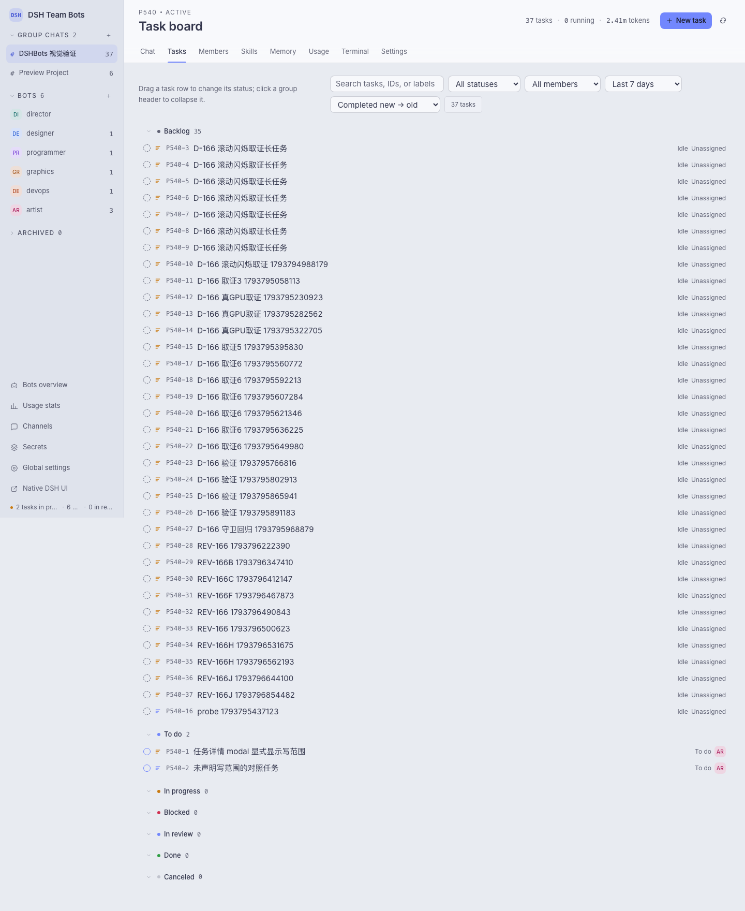
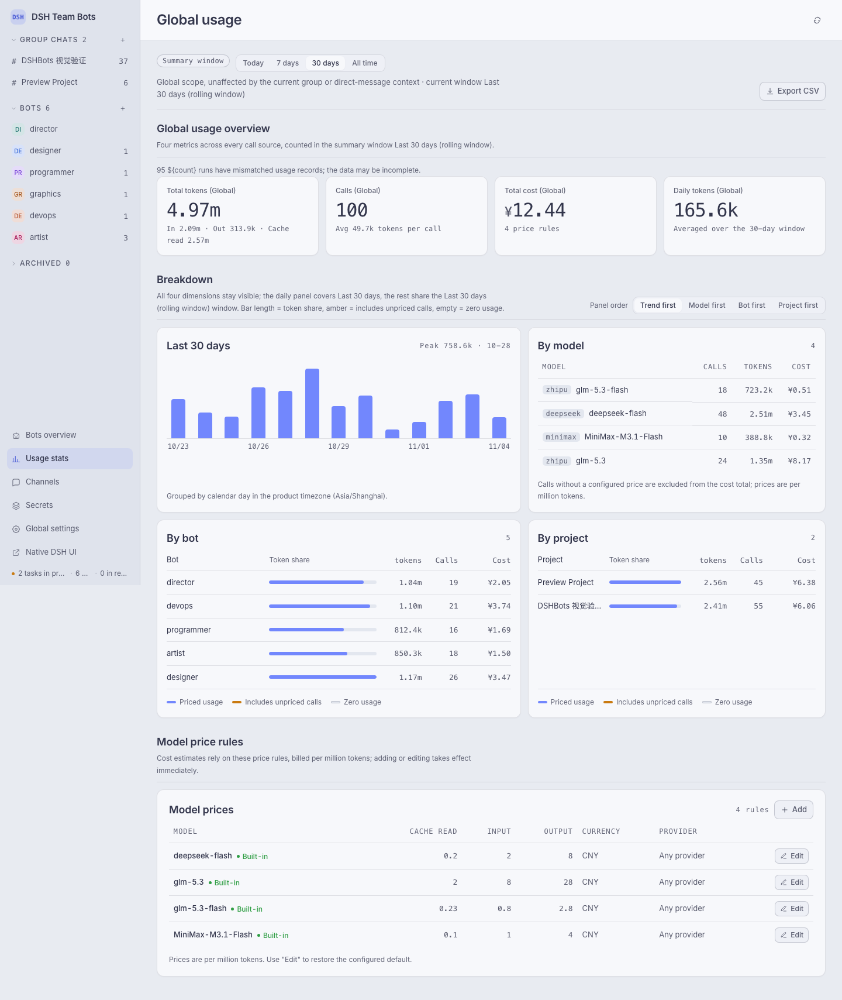
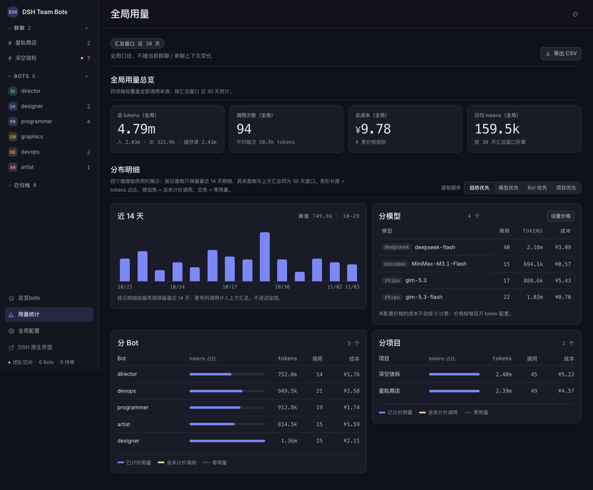

# DSH Team Bots

[简体中文](../README.md)

DSH team bots plugin (`dsh-team-bots`): run a crew of collaborating bots inside DSH — project chat, task dispatch, write-scope scheduling, terminal and usage stats, all in one workspace.


## Features

- **Project chat**: every project gets its own group chat and a project director bot. Supports plain messages, `@Bot`, `/task @Bot title`, `/remember`, `/clear`; typing `/` or `@` opens completion for commands, skills and members.
- **Task board**: a Linear-style task panel grouped by status, with parent/child task trees, priority and assignee, comments delivered straight into the running session, drag-to-transition, and delivery artifacts shown inline in the task detail.
- **Write-scope scheduling**: once a task declares the paths it will write, two write runs in the same project are judged by those scopes — non-overlapping scopes run in parallel, overlapping scopes or an undeclared side serialize, so shared workspaces are never stomped on and concurrency is not wasted; task sessions stay independent, and tasks never block chat replies.
- **Bot memory and skill pool**: bot-scoped and project-scoped long-term memory, with an automatic memory review after every turn; the shared skill pool is fixed at `~/.agents/skills`, and each project can also carry its own `.agents/skills`, `.claude/skills`, `.codex/skills`.
- **Versioned evolution**: role, model, effort and skill changes go through proposal review; every bot config keeps an immutable history that can be rolled back.
- **Team tools**: registers `team_assign_task`, `team_review_task`, `team_remember`, `team_recall`, `team_propose_evolution`, `team_message_bot`, `team_request_secret`; bots can also message each other directly.
- **Secret pipeline**: secrets are stored AES-256-GCM encrypted and materialized into the project's `.team/secrets.env`; values are masked as `$NAME` in messages and run output.
- **Usage stats**: tokens, call counts, cost and runtime are attributed globally, per project and per bot; cost is computed from configurable model prices, and calls without a price are never counted as zero.

## Install

Requires Node 22.19+ and the DSH CLI (`dsh --version` to check). The plugin runs in-process with DSH Web:

```sh
cd <repo>
npm pack                                        # produces dsh-team-bots-<version>.tgz
dsh plugin --profile <name> add ./dsh-team-bots-<version>.tgz
dsh --profile <name>                             # read the tokenized dsh web entry from the startup log
```

One-shot refresh (packs into the repo's `.dist/` and reinstalls into the given profile; default `team-bots`):

```sh
npm run profile:install -- --profile <name>
```

Team data is decoupled from the profile: the data directory is decided only by `DSH_TEAM_WORKSPACE` / `DSH_TEAM_DATA` (default `~/.dsh/workspace/team-bots/.data`), so installing into another profile — or running several installs side by side — reads and writes the same data. The shared skill pool is fixed at `~/.agents/skills`. A template for the common variables lives in `.env.example` at the repository root; export them with direnv or an editor dotenv plugin, and do not put a `.env` file in the repo root.

```text
http://<host>:<port>/                     auto-login, straight to the team workspace
http://<host>:<port>/api/dsh-team/ui      DSH Team Bots workspace (direct)
http://<host>:<port>/index.html           native DSH web UI
```

The first visit exchanges the startup token for a 30-day login cookie and redirects to the workspace, with no manual step. Auto-login means anyone who can reach that port gets owner access, so the service should listen on localhost or a trusted network only.

Common environment variables:

| Variable | Default | Purpose |
| --- | --- | --- |
| `DSH_TEAM_WORKSPACE` | `~/.dsh/workspace/team-bots` | team workspace root |
| `DSH_TEAM_DATA` | `<workspace>/.data` | team SQLite database and run records |
| `DSH_TEAM_MAX_RUNS` | `3` | global concurrent run limit |
| `DSH_TEAM_RUN_TIMEOUT_MS` | `900000` | hard timeout for a single run |
| `DSH_TEAM_MAX_RUN_TOKENS` | `0` | token cap per run, 0 disables the cap |
| `DSH_TEAM_STALL_TIMEOUT_MS` | `600000` | how long a run may go without new events before it counts as stalled |
| `DSH_TEAM_SECRET_KEY` | — | secret master key (64 hex characters) |
| `DSH_TEAM_MODEL_PRICES` | — | model prices as a JSON array |
| `DSH_TEAM_AGENT_TEAM` | `0` | enable the native Agent Teams layer |
| `DSH_TEAM_WECHAT` | `0` | WeChat channel |

## Development

```sh
npm run dev        # http://127.0.0.1:4317, fake runtime, data written to .dev/
npm test           # node --test "tests/*.test.js"
npm run doctor     # checks Node/DSH versions and writability of workspace and skill pool
```

`src/` holds the server and scheduler, `ui/` the workspace frontend, `tests/` the test suite, `docs/` design and review notes. The dev preview has no authentication, touches no DSH configuration, and is not for production.

CI: pushing a `v*` tag publishes to npm — the workflow runs the full test suite and publishes to registry.npmjs.org only when everything is green (see `.github/workflows/publish.yml`).

## Screenshots

The task board groups by status, so parent/child tasks and pending reviews are visible at a glance:



Usage stats separate the summary window from the last 14 days of detail, with cost computed from model prices:



The terminal page runs commands and keeps the history:


Dark mode:




## Security boundaries

- The plugin ships no sandbox: bot sessions execute commands as the current user under DSH's `danger-full-access`, with access to every file that user can reach.
- `<workspace>/{project}` is logical isolation, not a strong sandbox; do not let mutually untrusted teams share one DSH instance and workspace.
- Serving it publicly requires an HTTPS reverse proxy that forwards Host and WebSocket correctly.

## License

Apache-2.0, see `LICENSE` and `NOTICE` in the repository root.
