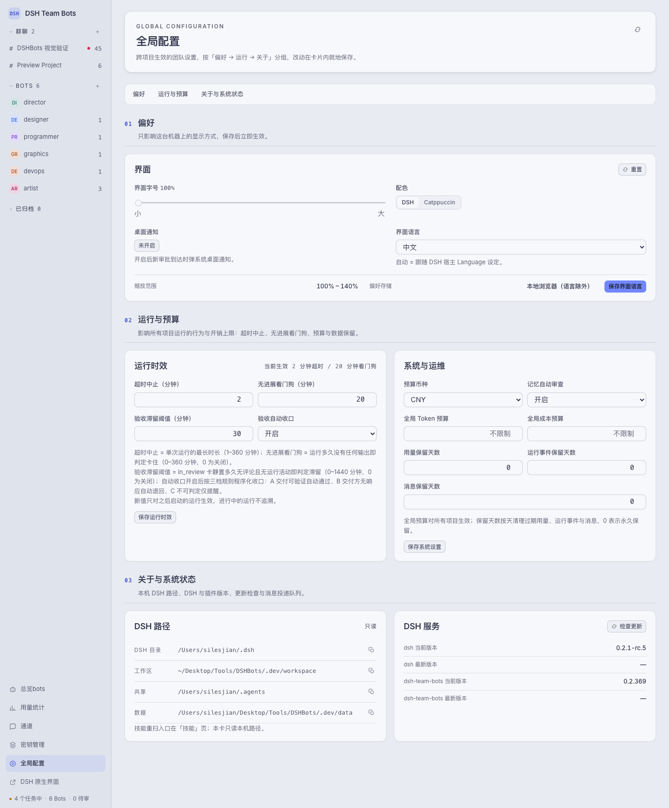

# DSH Team Bots

[English](../README.md)

`dsh-team-bots` 是一个 DSH 插件，把一个工作区变成一支团队：项目群聊、任务板、写范围并行调度、共享记忆与技能、审批卡、用量与成本，以及个人微信通道。每次运行都留下轨迹、时长、token 数与成本。


## 运行前提

- Node.js ≥ 22.19
- DSH 命令行（`dsh`）

插件运行在 DSH Web 进程内，没有独立服务，也不单独占端口。

## 安装

```sh
dsh plugin --profile <name> add dsh-team-bots
```

从源码装（打包当前工作树并装进指定 profile）：

```sh
npm run profile:install -- --profile <name>
```

profile 里的插件文件是一份快照。改完代码要重新安装，否则页面一直跑旧版本。

## 打开工作台

```text
http://<host>:<port>/                     DSH Web 首页，自动登录进团队工作台
http://<host>:<port>/api/dsh-team/ui      团队工作台本身
```

首次访问会把当前启动 token 换成 30 天登录 cookie。自动登录意味着能访问该端口的人就是 owner，请只监听本机或可信网络；要对外暴露，前面放一层转发 Host 与 WebSocket 的 HTTPS 反向代理。

## 工作台能做什么

### 群聊与调度

每个项目是一个群聊；单个 Bot 也可以被单独一对一调度。同一个 bot 的全部流量——任务派发、群聊、私信、单聊——都落到它唯一的一条控制面会话上，同一 bot 同时只跑一条运行，不同 bot 之间照旧并行。

### 任务板

状态：待规划、待执行、进行中、受阻、待验收、已完成、已取消。一张卡带负责人、优先级、父子任务、标签、写范围、可选的时效要求（硬性时限，到期中止运行）、评论，以及本卡自己的用量。任务行按状态分组，可拖到别的分组直接改状态。

### 写范围与并行调度

每张卡声明自己会写哪些路径（相对项目工作目录）。同一项目下两个运行只有在双方都声明了写范围、且路径前缀互不重叠时才并行；没声明写范围的卡按串行处理。紧急卡可以豁免排队，但豁免会写进建卡消息，不做静默处理。

### 记忆、技能与进化提案

记忆由 owner 写入、复核、冻结与归档，项目内所有 Bot 都能读到。技能来自共享技能根目录加项目级技能；改动走提案 → 审批 → 落地，先灰度再转全量。同一条路径也能改 Bot 的角色指令。

### 审批卡与提问卡

Bot 要工具审批、要密钥或要人回答时，工作台在聊天里出一张卡。owner 就地批准、拒绝或回答，结论记在卡上。

### 用量与成本

用量页按模型、按 Bot、按项目拆分，可导出 CSV，模型价格来自配置。


### 工作台设置

运行限制（超时中止、无进展看门狗、验收滞留阈值）、预算与保留天数按工作区设置，和界面偏好、本机 DSH 路径放在一起。



### 终端、通道与密钥

每个项目有终端，在项目目录里执行命令。微信通道扫码绑定后，把任务动态推给 owner 的微信。密钥分团队级与项目级，界面上只显示指纹，取值以一次性运行时副本下发，到期即失效。

## 配置

| 变量 | 默认值 | 含义 |
| --- | --- | --- |
| `DSH_TEAM_WORKSPACE` | `~/.dsh/workspace/team-bots` | 团队工作区根目录 |
| `DSH_TEAM_DATA` | `<workspace>/.data` | 数据库与运行记录 |

其余变量的默认值与解析顺序（显式环境变量 > 页面上保存的值 > 代码默认值）都写在 `src/config.ts`，常用项见 `.env.example`。不要在仓库根目录放 `.env`，否则 `DSH_*` 会泄进 `npm test` 和 `npm run dev`。

`DSH_TEAM_DATA` 下有 `team.sqlite`、`wechat-channel.sqlite`、`secret.key`、`memory/`、`messages/` 与 `secrets-runtime/`。备份时把 `secret.key` 和数据一起带走——没有它，已存的密文解不开。

## 开发

```sh
npm install
npm run build       # 把 TypeScript 编译成发布的 .js
npm run typecheck
npm test            # 先 build，再对 tests/ 与 scripts/ 跑 node --test
npm run dev         # 本地开发服务器：http://127.0.0.1:4317
npm run doctor      # 检查 node、dsh、路径与 profile 引用
```

另有几套工具：`npm run backup` / `npm run restore-check` 备份与校验数据，`npm run verify:agent-team` 验证 agent team 能力，`npm run load-test` 与 `npm run fault-test` 压运行时。

仓库结构：

```text
ui/            浏览器端工作台（modules、styles、中英文案）
src/           HTTP 接口、数据库、运行时与领域服务
src/services/  领域逻辑：chat、tasks、scheduler、memory、skills、approvals、usage
src/tools.ts   Bot 看到的工具面（team_* 系列）
scripts/       构建、开发服务器、doctor、发版、备份与测试工具
tests/         node:test 用例
```

## 发版

```sh
npm run release            # 加 --dry-run 可只打印计划，不做任何改动
```

工具先把 `dev` 推上去，再把 dev 落到 `main`（能快进就快进，否则落一份内容快照），推 `main` 与 tag，最后把 `dev` 同步回来。发布走 npm OIDC trusted publishing，不用 `NPM_TOKEN`，工作流在发布前会把 npm 升到 ≥ 11.5.1。

## 许可

Apache-2.0，见 `LICENSE` 与 `NOTICE`。
