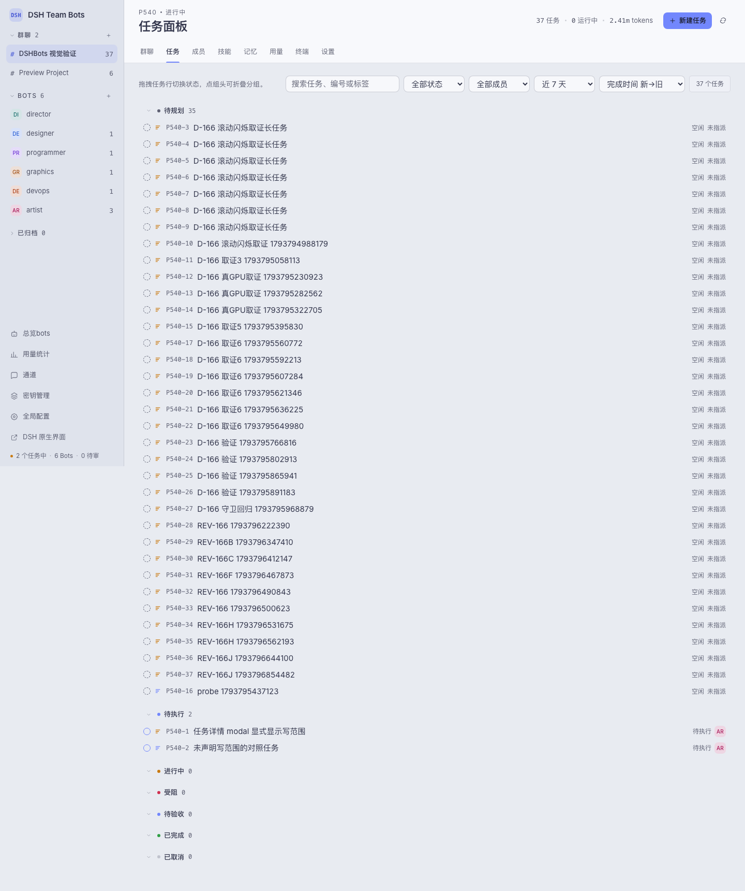
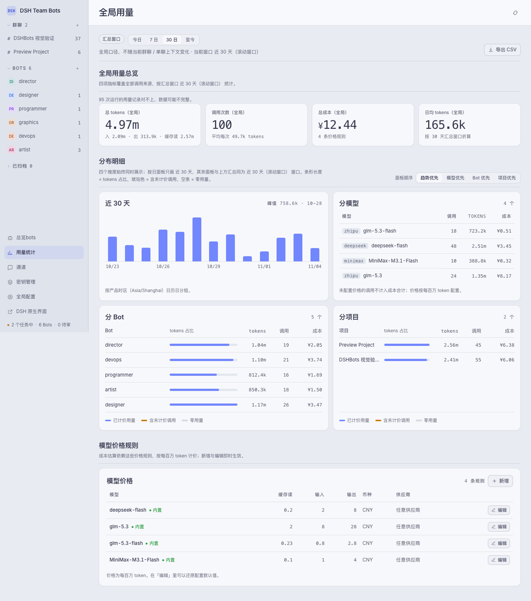
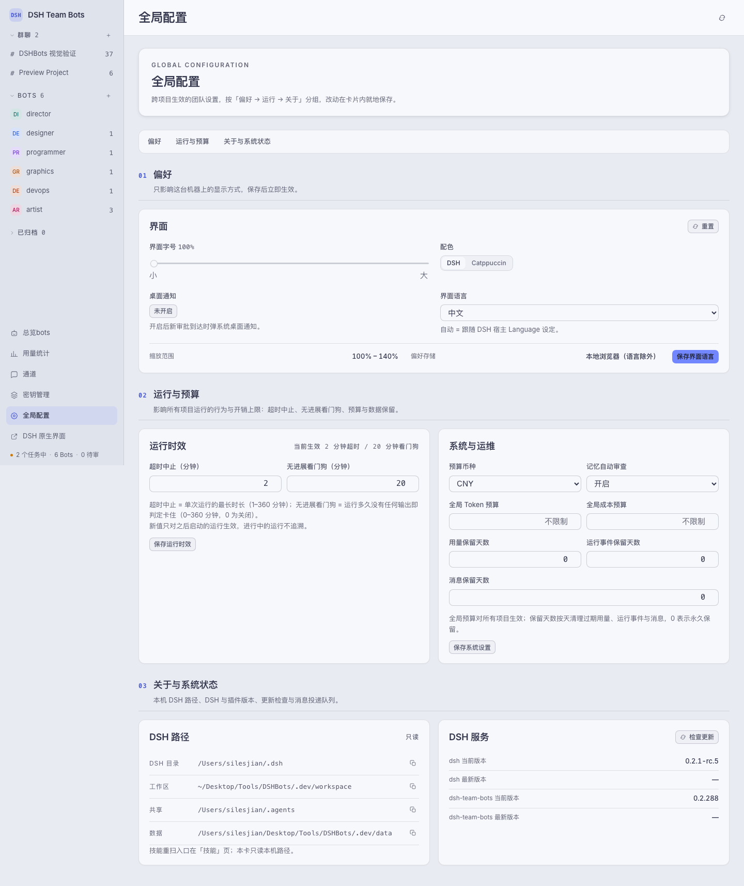

# DSH Team Bots

[English](../README.md)

DSH Team Bots 是 npm 包 `dsh-team-bots`，一个 DSH（DeepSeek Harness）插件，把一整个协作的 bot 团队装进同一个工作区：项目群聊、任务板、按写范围并行调度、记忆与技能、用量与成本，外加一条个人微信通道。每个 run 都保留轨迹、时长、token 数和成本。



## 安装

需要 Node.js ≥ 22.19 与 DSH CLI；插件跑在 DSH Web 进程里 —— 没有独立服务与端口。

```sh
dsh plugin --profile <name> add dsh-team-bots
dsh --profile <name>                             # 从启动日志里读带 token 的 dsh web 入口
```

包从 npm registry 解析，不需要 `npm pack` 或本地 tarball；在仓库里用 `npm run profile:install -- --profile <name>` 等价。

## 启动

```text
http://<host>:<port>/                     自动登录，直接进入团队工作区
http://<host>:<port>/api/dsh-team/ui      DSH Team Bots 工作区（直达）
http://<host>:<port>/index.html           DSH 原生 Web UI
```

首次访问首页会用当前启动 token 换一张 30 天登录 cookie。自动登录意味着**任何能访问到端口的人都是 owner**，所以请只监听本机或可信网络；要公网暴露，需要一个正确转发 Host 与 WebSocket 的 HTTPS 反向代理。

## 配置要点

真正要紧的两个路径是 `DSH_TEAM_WORKSPACE`（团队工作区根目录，缺省 `~/.dsh/workspace/team-bots`）和 `DSH_TEAM_DATA`（团队数据库与 run 记录，缺省 `<workspace>/.data`）；其余变量、缺省值和解析顺序（显式 env > 页面保存值 > 代码缺省）都在 `src/config.js`。

`DSH_TEAM_DATA` 下的数据包括 `team.sqlite`、`wechat-channel.sqlite`、`secret.key`、`memory/`、`messages/` 和 `secrets-runtime/`（TTL 到期即焚）。备份时请把 `secret.key` 一起带走 —— 没有它，已有的密文永远解不开。

常用变量的模板在 `.env.example`；**不要把 `.env` 放在仓库根目录**，否则 `DSH_*` 会漏进 `npm test` 和 `npm run dev`。profile 里的插件文件是快照：改了代码必须重装，否则页面会卡在「connecting to the team space」。

## 截图

用量统计带汇总窗口、最近 14 天明细、按模型 / 按 bot / 按项目拆分和 CSV 导出：



全局配置页只保留核心分组；通道、密钥、版本状态与价格规则在各自的一级页：



## License

Apache-2.0，见 `LICENSE` 与 `NOTICE`。
